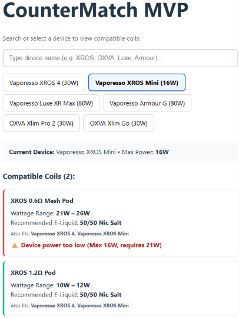

# CounterMatch (MVP)

**Instant hardware cross-compatibility, electrical safety validation, and point-of-sale lookup engine for specialist vape retail.**



---

## The Problem

Specialist vape retail involves high SKU complexity across hundreds of devices, pod platforms, coil resistances, and e-liquid viscosities[cite: 3]. During peak counter hours, new or junior staff face significant cognitive load trying to verify cross-compatibility on the fly—leading to[cite: 3]:
* **Lost sales** when a primary pod box is out of stock and staff do not realize an identical cross-compatible box sits two shelves over[cite: 3].
* **Preventable returns and safety issues** when low-resistance coils are paired with low-wattage devices or incompatible VG/PG ratios[cite: 3].
* **Slow onboarding** that bottlenecks senior staff during busy shifts[cite: 3].

## The Solution (v1.1)

CounterMatch is a fast, accessible lookup interface designed around **3-second counter ergonomics**[cite: 3]. Rather than forcing staff to scan dense specification tables, the UI prioritizes forgiving live search, reverse-lookup cross-compatibility, and instant visual safety guardrails[cite: 3].

### Core Features
* **Real-Time Case-Insensitive Search:** Memoized reactive filtering (`useState` + `useMemo`) narrows hardware options on every keystroke with a one-tap clear reset for rapid customer turnover[cite: 3].
* **Many-to-Many Compatibility Engine:** Hardware specifications are normalized in `src/data/catalog.js` so shared coil/pod ecosystems (e.g., Vaporesso XROS, GTX, OXVA Xlim) map cleanly across multiple device families without data duplication[cite: 3].
* **Reverse-Lookup Cross-Selling ("Also Fits"):** Uses a `Map`-indexed lookup utility (`src/utils/compatibility.js`) to automatically surface every device sharing the active coil platform, enabling counter staff to locate identical stock under alternative packaging when primary stock runs low[cite: 3].
* **Electrical & Viscosity Guardrails:** Separates *physical* fitment from *electrical* compatibility[cite: 2, 3]. If a pod physically fits a device but exceeds its maximum power output (`coil.minW > device.maxWattage`), the card remains visible for transparency while dynamically flagging an ARIA-compliant red under-power alert alongside recommended e-liquid ratios (`50/50 Nic Salt` vs. `70/30 High VG`)[cite: 2, 3].

---

## Architecture & Project Structure

Built with a strict **Separation of Concerns** so the pure compatibility engine and normalized dataset remain completely decoupled from UI rendering[cite: 3]:

```text
vape-counter/
├── src/
│   ├── data/
│   │   └── catalog.js          # Normalized many-to-many device & coil dataset
│   ├── utils/
│   │   └── compatibility.js    # Pure matching & electrical safety validation engine
│   ├── App.jsx                 # Accessible search & POS interface
│   ├── index.css               # Semantic, responsive design tokens & styles
│   └── main.jsx                # Application entry point
├── DECISIONS.md                # Engineering trade-offs, bug resolutions & UX rationale
├── index.html
└── package.json

### Getting Started

git clone [https://github.com/](https://github.com/)<your-username>/vape-counter.git
cd vape-counter
npm install
npm run dev